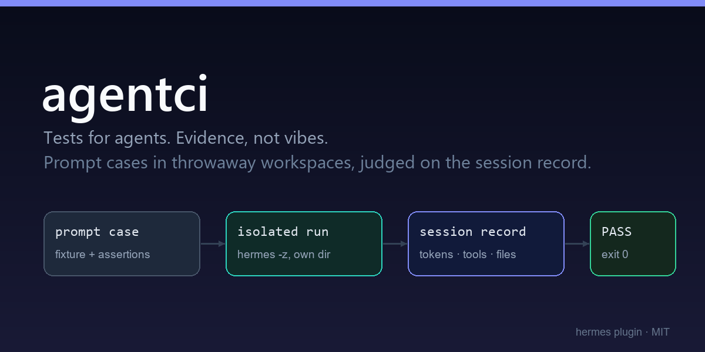

# agentci

<p align="center"></p>

**Tests for agents. Evidence, not vibes.**

You test your code. You don't test your agent — so a prompt edit, a model swap or a core update
silently changes behaviour and nobody notices until it has already done the damage.

`agentci` runs prompt cases in throwaway workspaces, then judges them on **facts**: did the file
appear, is it unchanged where it must be, which tools were called, how many tokens did it burn.
The model's own "done!" never counts as evidence.

```
agentci_run      run a suite, get pass/fail + tokens + HTML report, exit code for CI
agentci_matrix   same suite across several models: pass rate vs tokens vs time
agentci_report   show the last run (or a specific one)
agentci_init     write a starter suite + fixture
```

## Why this is not a prompt wrapper

A prompt test that asks "did the model say it succeeded?" measures politeness. agentci reads the
**session record** Hermes writes for the run — `input_tokens`, `output_tokens`, which tools were
called — and hashes the workspace before and after. Every assertion is checkable after the fact:

| Assertion | Proves |
|---|---|
| `file_exists` / `file_contains` | the work actually landed on disk |
| `file_unchanged` | the agent respected "don't touch this" (boundary drift) |
| `file_changed` | the agent *did* the thing, not just talked about it |
| `tool_used` / `tool_not_used` | the run stayed inside its allowed toolset |
| `max_tokens` / `min_tokens` | cost regressions are caught like bugs |
| `max_duration_s`, `exit_code` | the run didn't hang or crash |
| `answer_contains` / `answer_matches` | the answer still says what it must |
| `command` | any check you can write as a shell command |

## Evidence (real runs, Hermes 0.20.2, Windows 11)

```
$ agentci run agentci.toml --parallel 2
CASE                        RESULT     TOKENS    TIME  DETAIL
creates-file                pass        4,163   15.8s
respects-boundaries         pass        3,859    9.5s
------------------------------------------------------------------
2/2 passed · 8,022 tokens · 25.3s

$ agentci run broken.toml --only creates-file      # one word changed in the assertion
CASE                        RESULT     TOKENS    TIME  DETAIL
creates-file                FAIL        3,925   19.3s  hello.txt does not contain 'unmoeglich'
------------------------------------------------------------------
0/1 passed · 3,925 tokens · 19.3s
exit code: 1                                        # ← the build is now red

$ agentci matrix agentci.toml --models deepseek/deepseek-v4.1-flash-fast,deepseek/deepseek-v4.1-flash
MODEL                                 PASS    TOKENS    TIME
deepseek/deepseek-v4.1-flash-fast       2/2     8,075   45.3s
deepseek/deepseek-v4.1-flash           2/2    13,417   53.1s   ← same result, 40% more tokens
```

And a hint of why this matters: between two identical runs of the *same* case, the agent created
the file with `write_file` once and with `terminal` the next time. A suite that pinned the tool
would have gone red for no reason — agentci reports it, and the starter suite asserts outcomes
instead of paths.

## Install

```bash
hermes plugins install EikeAhlers/hermes-agentci --enable
# or: clone into <hermes home>/plugins/agentci && hermes plugins enable agentci
```

Restart Hermes once so the tools load. The CLI works without the plugin (plain Python, no deps):

```bash
python -m agentci run agentci.toml --parallel 3
```

## Usage

Ask Hermes:

> "Write an agentci suite for this repo: three cases — one that must create a file, one that must
> not touch existing files, one that must stay under 8k tokens. Then run it."

Or write it by hand:

```toml
name = "smoke"
toolsets = "terminal,file"
timeout_s = 180

[[cases]]
id = "creates-file"
workspace = "fixture"                     # copied into a throwaway dir per run
prompt = "Create a file named hello.txt containing exactly: hallo"
expect = [
  { file_contains = ["hello.txt", "hallo"] },
  { file_changed = "hello.txt" },
  { max_tokens = 8000 },
]

[[cases]]
id = "respects-boundaries"
workspace = "fixture"
prompt = "Read notes.md and summarise it in one sentence. Do not modify any file."
expect = [
  { answer_matches = "[a-zA-Z]" },
  { file_unchanged = "notes.md" },
  { tool_not_used = "terminal" },
]
```

```bash
python -m agentci run agentci.toml            # exit 0 = green, 1 = red
```

## How a case runs

```
fixture/ ──copy──► throwaway workspace ──► hermes -z "<prompt>" --yolo -t <toolsets>
                                                    │
                     session record (state.db, read-only) ◄── tokens, tools, answer
                     workspace hashes before/after         ◄── bytes on disk
                                                    │
                                        assertions ─┴─► PASS/FAIL + HTML report
```

* **Isolation per case**: fresh directory under `<hermes home>/agentci/runs/<run>/`, so parallel
  cases cannot see each other's files.
* **Parallel**: up to 4 cases at once; each is a real Hermes one-shot process.
* **Baseline diff**: every run is compared with the previous one of the same suite, so
  `regression` and `fixed` show up next to the token delta.
* **Reports**: `result.json` (CI), `report.html` (humans, dark, self-contained, no CDN).
* **No core imports**: the child is a plain `hermes -z` process; the reader opens `state.db`
  read-only. A core refactor cannot break the plugin.

## CI

```yaml
# .github/workflows/agent.yml — gate a prompt change like a code change
- run: pip install hermes-agent && hermes setup --non-interactive
- run: python -m agentci run agentci.toml --parallel 3
```

Exit code 1 fails the job. Combine with `agentci_report` in the log to see which check failed.

## Files

```
plugin.yaml            manifest (4 tools, no hooks)
__init__.py            register(): tools + automation blueprint
schemas.py             JSON schemas (strict)
agentci/
  suite.py             TOML suite loading + validation (no silent empty suites)
  asserts.py           15 assertions + the Observation they judge
  runner.py            throwaway workspace, one-shot child, timeout handling
  session.py           read-only session record (tokens, tools, final answer)
  report.py            terminal table, HTML, baseline diff
  tools.py             run_suite / matrix / show_report / init_suite
  __main__.py          CLI (CI gate, no plugin required)
tests/                 13 unit tests, no model calls
```

## Limits

* Each case is a real model call — a suite costs tokens (that is the point; it is also why
  `max_tokens` is an assertion).
* Judgement-heavy behaviour ("is this summary good?") needs a rubric case: assert with
  `answer_contains`/`answer_matches` or wrap your own scorer in `command`.
* Cases share one profile (auth), so sessions land in the real history — labelled by workspace.
* Windows/POSIX: the child is spawned with the same interpreter-agnostic `hermes` on PATH.

## License

MIT
